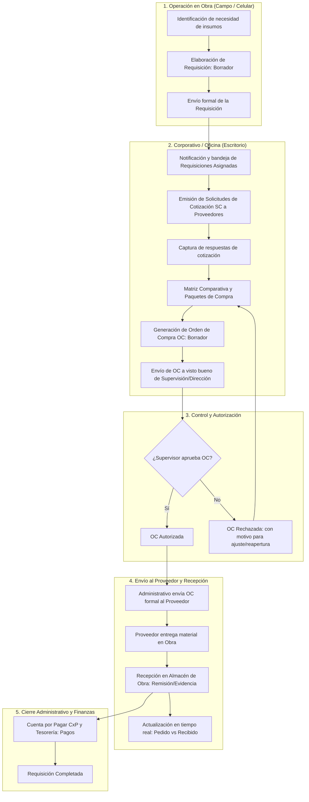

# Proceso de Requisiciones en ERP PNF: Obra y Corporativo

Este documento describe detalladamente el ciclo de vida y proceso funcional de las **Requisiciones de Materiales e Insumos** dentro del sistema ERP PNF, distinguiendo la operación en **campo (obra)** y la gestión en **oficina/corporativo (administración y dirección)**.

---

## 1. Visión General del Proceso

El flujo de requisición es el punto de partida de la cadena de suministro de una constructora en ERP PNF. Conecta la necesidad física de insumos en el frente de trabajo con el control administrativo y financiero corporativo:

---

## 2. Roles y Responsabilidades

| Rol | Ubicación | Responsabilidad en el Proceso de Requisición |
| :--- | :--- | :--- |
| **Residente** | Obra (Móvil) | Responsable de la obra. Registra, valida y envía formalmente la requisición con las fechas en que se requieren los materiales. Recibe los materiales y valida remisiones. |
| **Auxiliar** | Obra (Móvil) | Apoya en la captura de borradores de requisición y conteo de insumos. |
| **Administrativo** | Corporativo (Desktop) | Monitorea requisiciones enviadas por todas las obras, emite solicitudes de cotización (PDF), captura precios de proveedores, elabora la matriz comparativa y genera las Órdenes de Compra (OC). |
| **Supervisor** | Obra / Corporativo | Filtro de control técnico y presupuestal. Revisa paquetes y autoriza o rechaza las Órdenes de Compra con justificación. Nada se compra ni se paga sin su visto bueno. |
| **Director** | Corporativo (Desktop) | Acceso y visibilidad total. Puede autorizar OCs, consultar comparativas y monitorear el condensado de compras y pagos. |

---

## 3. Proceso en Obra (Campo / Vista Móvil)

El módulo de requisiciones en obra (`/app/obras/[obraId]/requisiciones`) está optimizado para dispositivos móviles, pensado para operarse de pie y con agilidad.

### 3.1 Captura y Guardado de Borradores
1. **Acceso:** El Residente o Auxiliar ingresa a la obra correspondiente en el ERP y selecciona el módulo **Requisiciones**.
2. **Creación:** Se abre la hoja de captura (`NuevaRequisicionSheet`).
3. **Selección de Insumos:**
   - Búsqueda en el catálogo maestro de insumos autorizado de la empresa.
   - Definición de cantidad requerida y fecha límite en que se necesita el material en campo.
   - Posibilidad de agregar notas específicas por partida (ej. especificaciones técnicas, marcas sugeridas, ubicación de descarga).
   - Validación automática de insumos: el sistema no permite agregar insumos marcados como rechazados o inactivos en el catálogo.
4. **Modo Borrador:** 
   - El personal de obra puede guardar avances parciales (`BORRADOR-XXXXXX`).
   - Los borradores son privados y solo visibles para el usuario que los creó hasta su envío definitivo.

### 3.2 Envío Formal de la Requisición
1. Al verificar cantidades y fechas, el usuario presiona **Enviar Requisición**.
2. El sistema valida las líneas de insumos y asigna automáticamente el siguiente folio consecutivo oficial de la empresa (ej. `REQ-00123`).
3. El estado cambia a **`enviada`**.
4. **Notificaciones inmediatas:** Se dispara una alerta y notificación automática a los usuarios administrativos y directores vinculados a la empresa para informar que la obra requiere insumos.
5. **Cancelación:** Mientras la requisición permanezca en estatus `enviada` y no haya iniciado cotización, el solicitante original puede cancelarla si la necesidad cambió.

### 3.3 Seguimiento en Campo (Visor de Requisición y Trazabilidad)
Desde la obra, el equipo de campo puede abrir el visor de la requisición en cualquier momento para consultar:
- **Línea de tiempo (Timeline):** Estado del flujo (`Enviada` → `Cotizando` → `Pendiente de Autorización` → `OC Generada` → `Completada`), indicando fecha, hora y responsable de cada etapa.
- **Estatus de abasto por insumo:** Detalle partida por partida con contadores dinámicos de:
  - **Requerido:** Cantidad pedida en la requisición.
  - **Pedido:** Cantidad amarrada en Órdenes de Compra activas.
  - **Recibido:** Cantidad real que ya ingresó al almacén de la obra.

---

## 4. Proceso en Corporativo / Oficina (Vista Administrativa Desktop)

El módulo corporativo (`/app/admin/requisiciones`) consolida las requisiciones activas e históricas de todas las obras de la constructora.

### 4.1 Bandeja de Entrada Centralizada
- **Filtros operativos:** La administración puede filtrar por obra, residente responsable o solicitante.
- **Priorización por urgencia:** El listado se ordena por la fecha requerida más próxima de los insumos, permitiendo atender primero los suministros críticos para no parar frentes de trabajo.
- **Acceso a gestión:** Al hacer clic en una requisición, el administrativo abre el gestor integral (`CotizacionSheet`) con sus cinco pestañas operativas:
  1. `Requisición` (partidas base y datos de origen).
  2. `Solicitudes` (cotizaciones a proveedores).
  3. `Comparativa` (matriz de precios y adjudicación de paquetes).
  4. `Órdenes de Compra (OCs)` (seguimiento a órdenes y pagos).
  5. `Recepciones` (control de entregas y remisiones).

### 4.2 Emisión de Solicitudes de Cotización (SC)
1. **Creación de Solicitud:** El administrativo selecciona los insumos de la requisición y el proveedor del catálogo de terceros.
2. **Generación de PDF formal:** El sistema emite la Solicitud de Cotización oficial en PDF con folio, datos fiscales de la constructora, desglose de partidas y condiciones solicitadas.
3. **Registro de estado:** Las SC pasan por los estados: `borrador` → `enviada` → `recibida` (o `descartada`).
4. **Captura de respuestas:** Al recibir la propuesta del proveedor (por correo o WhatsApp), el administrativo captura precios unitarios, tiempos de entrega y condiciones comerciales.

### 4.3 Matriz Comparativa y Paquetes de Compra
1. **Comparativa lado a lado:** La pantalla despliega una tabla comparativa matricial con todos los proveedores cotizados para cada partida, destacando el mejor precio unitario.
2. **Asignación en paquetes:**
   - La compra puede adjudicarse a un solo proveedor o dividirse en múltiples paquetes entre distintos proveedores (ej. acero con un proveedor y agregados con otro).
   - Se validan cantidades para no sobrepasar lo requerido sin justificación.

### 4.4 Generación y Envío de la Orden de Compra (OC)
1. Con los precios y proveedores confirmados en el paquete, el administrativo genera la **Orden de Compra**.
2. La OC nace con folio oficial consecutivo (ej. `OC-00045`) en estatus `borrador`.
3. El administrativo envía la OC a **revisión de Supervisión**.
4. El estatus de la OC cambia a `pendiente_autorizacion` y el estatus global de la requisición se actualiza automáticamente.
5. Se envía notificación directa a los supervisores de la obra.

---

## 5. Autorización de Compras (Visto Bueno de Supervisión y Dirección)

Siguiendo el principio de ERP PNF *"Nada se ejecuta sin visto bueno"*:
1. **Revisión en contexto:** El Supervisor o Director ingresa a la requisición y revisa la OC, el paquete comparativo y los importes totales.
2. **Decisión:**
   - **Autorizar:** La OC pasa a estatus `autorizada`. Se notifica a la administración para que proceda con la emisión al proveedor.
   - **Rechazar:** Requiere obligatoriamente capturar el **motivo de rechazo** (ej. "Precio unitario fuera de presupuesto", "Cambiar de proveedor por tiempo de entrega"). La OC pasa a `rechazada`.
3. **Reapertura de OC rechazada:** La administración puede reabrir una OC rechazada para corregir cantidades, renegociar precios o cambiar de paquete, reiniciando el ciclo de validación.

---

## 6. Envío al Proveedor, Recepción en Almacén y Liquidación

### 6.1 Notificación al Proveedor y a la Obra
1. Una vez autorizada la OC, el Administrativo la marca como **Enviada al proveedor**.
2. El sistema envía automáticamente una notificación al **Residente de Obra**: *"OC XXXX enviada al proveedor [Nombre]. Prepara la recepción del material"*.

### 6.2 Recepción en Almacén de Obra
1. Cuando el camión o fletera llega a la obra, el Residente registra la recepción física en el módulo de Almacén vinculado a la OC:
   - Número de remisión del proveedor (o justificación si llegó sin remisión).
   - Fotografía / archivo digital de la remisión firmada con sello de recibido.
   - Cantidades físicas recibidas por partida (permite recepciones parciales).
2. **Cierre de Requisición:** Si todas las OCs de la requisición completaron su recepción y liquidación, la requisición pasa automáticamente a estatus **`completada`**.

### 6.3 Enlace con Cuentas por Pagar (CxP) y Tesorería
- Las OCs autorizadas y enviadas generan la obligación en **Cuentas por Pagar**.
- Administración programa y ejecuta pagos (totales o parciales) desde **Tesorería**, afectando cuentas bancarias y pólizas contables de la obra.

---

## 7. Matriz de Estados de la Requisición

| Estado | Significado | Ubicación Principal de Acción |
| :--- | :--- | :--- |
| **`borrador`** | Requisición en captura inicial. Solo visible para su creador. | Obra (Residente / Auxiliar) |
| **`enviada`** | Solicitud formal de la obra en espera de atención de compras. | Obra / Corporativo |
| **`en_cotizacion`** | Administración está gestionando SCs y capturando ofertas de proveedores. | Corporativo (Administrativo) |
| **`pendiente_autorizacion`** | Se generó al menos una OC que requiere visto bueno. | Obra / Corporativo (Supervisor / Director) |
| **`oc_generada`** | OCs aprobadas y enviadas a proveedores; en proceso de entrega. | Corporativo / Obra |
| **`completada`** | Todos los insumos fueron recibidos en almacén de obra y las OCs quedaron saldadas. | Obra / Corporativo |
| **`rechazada`** | Descartada por supervisión o cancelada. | Obra / Corporativo |

---

## 8. Principios Clave del Sistema Reflejados en el Flujo

1. **La obra es la unidad de todo:** Cada requisición, cotización, OC y remisión de almacén está estrictamente vinculada al ID de la obra y a su presupuesto.
2. **Aislamiento multiempresa:** Folios, catálogos de insumos y aprobaciones se aíslan por empresa (`company_id`) tanto en lógica de negocio como mediante políticas RLS en PostgreSQL.
3. **Validación en Servidor:** Las acciones no se protegen solo ocultando botones en la interfaz; funciones como `crearRequisicion`, `guardarPaquete`, `generarOC`, `autorizarOC` y `rechazarOC` validan permisos específicos (`requisiciones.crear`, `cotizaciones.gestionar`, `oc.crear`, `oc.autorizar`, `oc.cancelar`) en el servidor.
