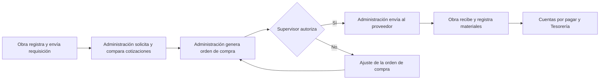

# Proceso de requisiciones

## Objetivo

Atender las necesidades de materiales de cada obra con trazabilidad, control presupuestal y autorización antes de comprar.

## Flujo ejecutivo

## Responsables

| Responsable | Participación |
| --- | --- |
| **Residente** | Registra la necesidad, confirma cantidades y fechas, y valida la recepción en obra. |
| **Auxiliar** | Apoya la captura; sus registros requieren visto bueno del Residente. |
| **Administrativo** | Gestiona cotizaciones, comparativas, órdenes de compra y pagos. |
| **Supervisor** | Revisa y autoriza o rechaza la orden de compra, indicando el motivo. |
| **Director** | Da seguimiento corporativo y puede autorizar compras. |

## Puntos de control

- **Autorización previa:** la orden de compra requiere visto bueno antes de enviarse al proveedor.
- **Trazabilidad:** cada requisición se vincula a su obra y permite dar seguimiento a lo requerido, comprado y recibido.
- **Recepción comprobable:** la obra registra cantidades recibidas y evidencia de entrega; se admiten entregas parciales.
- **Control de acceso:** permisos y aislamiento de datos por empresa se validan en servidor.

## Resultado

La requisición se completa cuando los materiales se reciben y las órdenes de compra asociadas quedan liquidadas.
